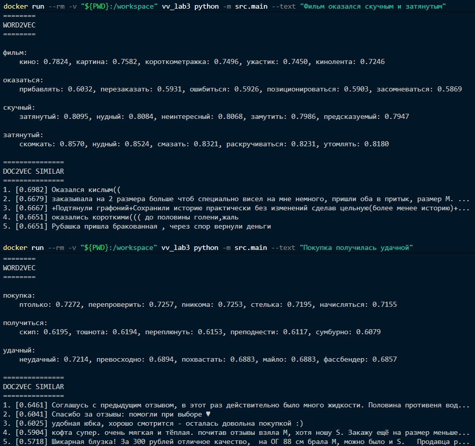

# Второй прототип семантического анализатора естественного языка

Анализатор [Lab-2](../Lab-2/README.md) (TF-IDF + LSA) расширен эмбеддингами
**Word2Vec** и **Doc2Vec**. На одном корпусе считаются темы LSA, векторы слов
и векторы документов; набор документов сравнивается по cosine в пространстве Doc2Vec.


## Структура

В директории [src](./src/) находятся:

- [Tokenizer](./src/tokenizer.py) - регулярное выражение для выделения слов и чисел
  (как в Lab-2);
- [Normalizer](./src/normalizer.py) - стоп-слова, нижний регистр и леммы (как в Lab-2);
- [LSA](./src/lsa.py) - TF-IDF, TruncatedSVD и query steering (как в Lab-2) + Word2Vec и Doc2Vec;
- [Train](./src/train.py) - модуль обучения LSA;
- [Main](./src/main.py) - CLI-модуль для запуска.

В [models](./models/) лежит обученная модель `lsa.joblib`.
Для обучения использовался тот же датасет, что и в Lab-2.


## Запуск

Запуск выполняется в **Docker**:

1. `docker build -t vv_lab3 .` - собрать образ в текущей директории;
2. Обучение (если моделей еще нет):
    `docker run --rm -v "${PWD}:/workspace" vv_lab3 python -m src.train`

3. `docker run --rm -v "${PWD}:/workspace" vv_lab3 python -m src.main`

    Нужен `--text "<текст>"` или `--file <путь>`. Файл должен лежать в текущей
    директории: она монтируется в контейнер. Каждая непустая строка файла - отдельный
    документ. Для двух и более строк дополнительно печатается попарная близость Doc2Vec.

    Примеры:

    ```bash
    docker run --rm -v "${PWD}:/workspace" vv_lab3 python -m src.main --text "Фильм оказался скучным и затянутым"
    docker run --rm -v "${PWD}:/workspace" vv_lab3 python -m src.main --text "Фильм оказался скучным и затянутым" --steer 0:1.5,3:-0.8
    docker run --rm -v "${PWD}:/workspace" vv_lab3 python -m src.main --file example.txt
    ```

4. `docker rmi vv_lab3` - удалить образ.


### Примеры работы




## Обучение

Датасет кладется в `data/dataset.csv` (`DATASET_PATH`). Ожидается *csv* с колонкой
текста (`TEXT_COL`). Если строк больше `MAX_DOCS`, берется случайная выборка.
`N_TOPIC_COMPONENTS` задает число тем LSA. `VECTOR_SIZE`, `WINDOW` и `EPOCHS`
задают параметры Word2Vec и Doc2Vec. Пареметры можно настроить в [train.py](./src/train.py).
Сложные предобработки не предусмотрены.


## Результат

Для каждого документа CLI печатает разбор Lab-2 и блок эмбеддингов:

- **PREPROCESSING**, **TF-IDF**, **TOPIC VECTOR**, **TOPICS**, **STEERING** - как в Lab-2;
- **TOPIC SIMILAR** - ближайшие документы корпуса по cosine в пространстве тем;
- **WORD2VEC** - ближайшие слова для слов запроса, которые есть в словаре;
- **DOC2VEC SIMILAR** - ближайшие документы корпуса по cosine векторов Doc2Vec;
- **DOC2VEC PAIRWISE** - если на входе несколько документов, cosine между каждой парой.
