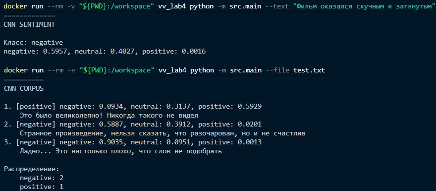

# Третий прототип семантического анализатора естественного языка

Анализатор [Lab-3](../Lab-3/README.md) расширен сверточной сетью **TextCNN** на PyTorch.
Корпус документов классифицируется по тональности (`negative` / `neutral` / `positive`).


## Описание модели

Сеть представляет собой несколько одномерных сверток на одних и тех же эмбеддингах
с разными размерами ядра, функция активации - ReLU. К выходу каждой свертки применяется
max-pooling. Затем идет слой dropout по объединенном данным и полносвязный слой.
При выводе в конце дополнительно используется softmax.

В начале обучения эмбеддинги инициализируются векторами из Word2Vec того же корпуса.
Также собирается словарь слов, где каждой лемме присваивается уникальный индекс.


## Структура

В директории [src](./src/) находятся:

- [Tokenizer](./src/tokenizer.py) - регулярное выражение для выделения слов и чисел
  (как в Lab-3);
- [Normalizer](./src/normalizer.py) - стоп-слова, нижний регистр и леммы (как в Lab-3);
- [LSA](./src/lsa.py) - TF-IDF, TruncatedSVD, Word2Vec, Doc2Vec и TextCNN;
- [Train](./src/train.py) - модуль обучения LSA и CNN;
- [Main](./src/main.py) - CLI-модуль для запуска.

В [models](./models/) лежит обученная модель `lsa.joblib`.
Для обучения использовался тот же датасет, что и в Lab-3 + колонка с меткой тональности.


## Запуск

Запуск выполняется в **Docker**:

1. `docker build -t vv_lab4 .` - собрать образ в текущей директории;
2. Обучение (модель Lab-3 без CNN не подходит, необходимо обучить заново):
    `docker run --rm -v "${PWD}:/workspace" vv_lab4 python -m src.train`

3. `docker run --rm -v "${PWD}:/workspace" vv_lab4 python -m src.main`

    Нужен `--text "<текст>"` или `--file <путь>`. Файл должен лежать в текущей
    директории: она монтируется в контейнер. Каждая непустая строка файла - отдельный
    документ. Для двух и более строк дополнительно печатается попарная близость
    Doc2Vec и сводка CNN по корпусу.

    Примеры:

    ```bash
    docker run --rm -v "${PWD}:/workspace" vv_lab4 python -m src.main --text "Фильм оказался скучным и затянутым"
    docker run --rm -v "${PWD}:/workspace" vv_lab4 python -m src.main --text "Фильм оказался скучным и затянутым" --steer 0:1.5,3:-0.8
    docker run --rm -v "${PWD}:/workspace" vv_lab4 python -m src.main --file example.txt
    ```

4. `docker rmi vv_lab4` - удалить образ.


### Примеры работы




## Обучение

Датасет кладется в `data/dataset.csv` (`DATASET_PATH`).
Ожидается *csv* с колонками текста (`DATASET_TEXT_COL`) и метки (`DATASET_LABEL_COL`).
Метки `0/1/2` отображаются в `neutral/positive/negative` (`LABEL_MAP`).
Если строк больше `DATASET_MAX_DOCS`, берется случайная выборка. `LSA_N_TOPIC_COMPONENTS`
задает число тем LSA. `LSA_VECTOR_SIZE`, `LSA_WINDOW` и `LSA_EPOCHS` задают параметры
Word2Vec и Doc2Vec. `CNN_MAX_LEN`, `CNN_FILTERS`, `CNN_KERNEL_SIZES` и `CNN_EPOCHS`
задают TextCNN. Параметры можно настроить в [train.py](./src/train.py).
Сложные предобработки не предусмотрены.


## Результат

Для каждого документа CLI печатает разбор Lab-3 и блок CNN:

- **PREPROCESSING**, **TF-IDF**, **TOPIC VECTOR**, **TOPICS**, **STEERING**, **TOPIC SIMILAR**,
    **WORD2VEC**, **DOC2VEC SIMILAR**, **DOC2VEC PAIRWISE** - как в Lab-3;
- **CNN SENTIMENT** - класс тональности и вероятности TextCNN;
- **CNN CORPUS** - если на входе несколько документов, метки всего корпуса и распределение классов.
